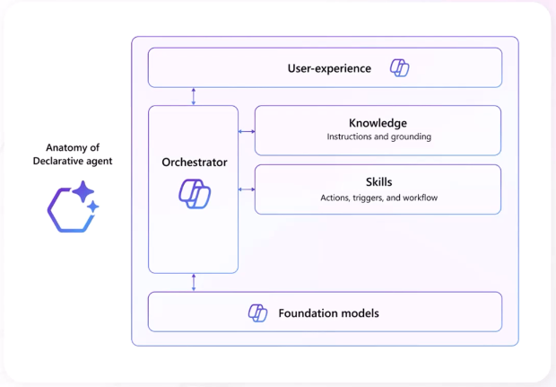
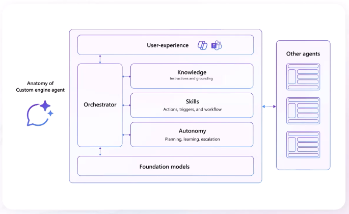
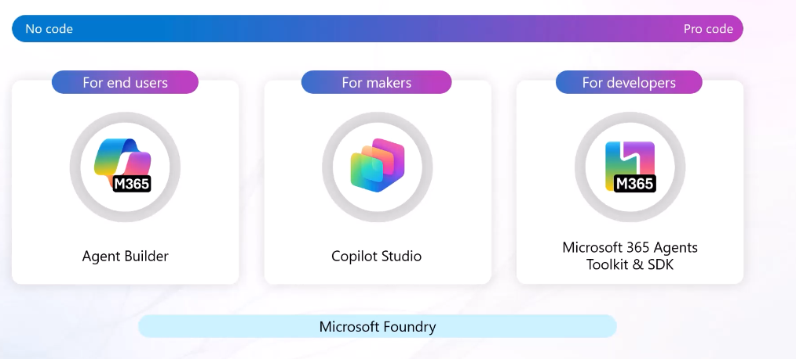

# Copilot Agents

## Approaches to Build Agents for Microsoft Copilot

| Approach | Description |
|----------|-------------|
| **Declarative approach** | Utilizes your instructions, knowledge, and actions along with Copilot's orchestrator and models. |
| **Custom engine approach** | Bring your own orchestrator and models to create a fully tailored agent. |

## Declarative Agents

| Aspect | Description |
|----------|-------------|
| Purpose | Declarative agents enable you to configure Copilot for specific scenarios by adding custom instructions, additional knowledge, and tools to automate business processes. |
| Governance & Security | Because declarative agents use Copilot's AI infrastructure, model, and orchestrator, they adhere to the security, compliance, and Responsible AI (RAI) requirements for Microsoft 365. |

## Custom Engine Agents

Custom engine agents are fully customized AI assistants. They're useful for scenarios that require complex workflows, orchestration, or specific language models.

## Choose What Type of Agent to Build

| Category | Platform / Technology | Available Solutions | Availability |
|----------|----------------------|---------------------|-------------|
| **Custom Engine Agents** | Azure Bot Service | - Copilot Studio custom agents - Agent SDK - Teams AI Library | Microsoft 365 Copilot and external channels |
| **Declarative Agents** | Microsoft 365 Copilot | - Agent Builder - Visual Studio Code - Copilot Studio Declarative Agents (DA) | Microsoft 365 Copilot and Microsoft Teams |

### Simplified View

| Agent Type | Build With | Best For | Can Run Outside M365 Copilot? |
|------------|------------|----------|-------------------------------|
| **Declarative Agents** | Agent Builder, Visual Studio Code, Copilot Studio DA | Extending Microsoft 365 Copilot using instructions, knowledge, and actions | Teams |
| **Custom Engine Agents** | Azure Bot Service, Agent SDK, Teams AI Library, Copilot Studio Custom Agents | Fully customized AI solutions with custom orchestration and models | Teams, Direct Line |

