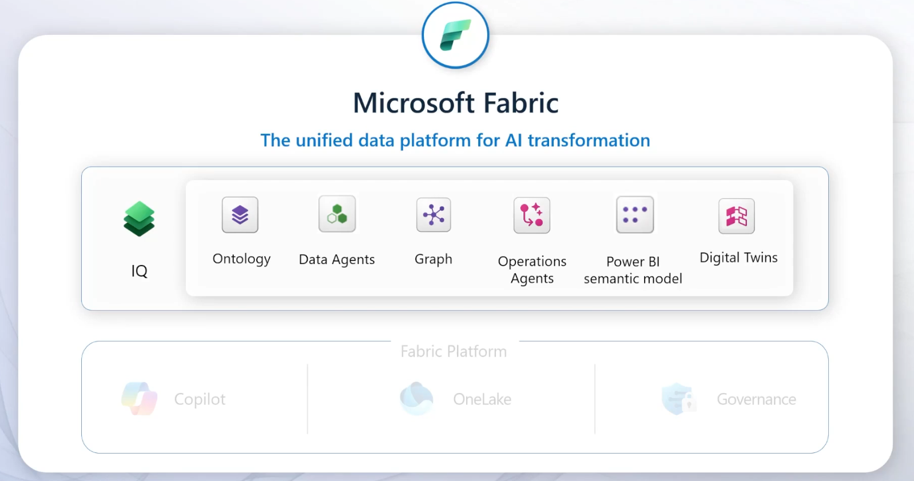
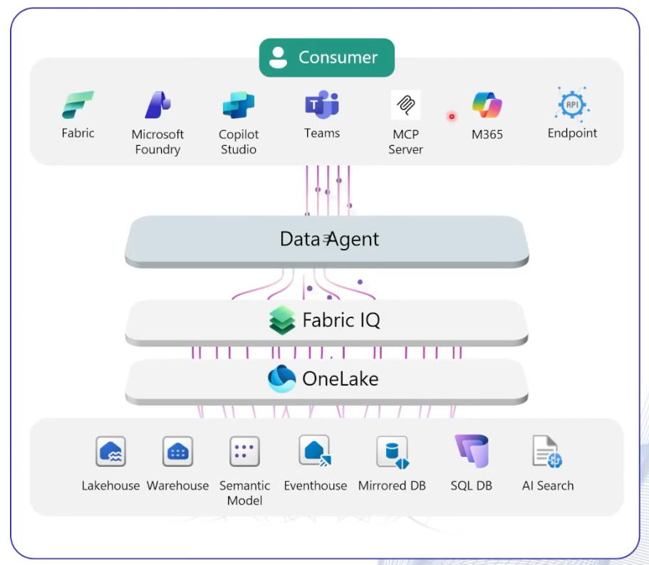

# Microsoft Fabric IQ

## Unified Data Platform for AI Transformation

Microsoft Fabric IQ is the intelligence layer within Microsoft Fabric that combines semantic understanding, business context, graph relationships, AI agents, and operational intelligence to enable enterprise-grade AI solutions grounded in business data.

## Core Components of Fabric IQ

| Component | Description | Business Value |
|-----------|-------------|----------------|
| **Ontology** | Provides a business-aware semantic representation of enterprise entities, concepts, relationships, and processes. | Establishes a common business language across data, analytics, and AI solutions. |
| **Data Agents** | AI agents that can understand, retrieve, analyze, and act on enterprise data using natural language. | Enables conversational analytics and automated decision support. |
| **Graph** | Maintains relationships between people, processes, systems, data assets, and business entities. | Improves context-aware reasoning and discovery across the enterprise. |
| **Operations Agents** | AI agents that monitor events, execute workflows, and automate operational business processes. | Reduces manual effort and accelerates operational responses. |
| **Power BI Semantic Model** | Business-friendly abstraction layer over enterprise data that provides governed metrics and dimensions. | Ensures consistent reporting, analytics, and AI responses. |
| **Digital Twins** | Digital representations of business assets, processes, environments, or physical systems. | Supports simulation, monitoring, optimization, and predictive analysis. |

## Fabric IQ Foundation Services

Fabric IQ is built on top of the Microsoft Fabric platform and leverages:

| Platform Service | Purpose |
|------------------|---------|
| **Copilot** | Natural language interaction and AI-powered experiences. |
| **OneLake** | Unified multi-cloud data lake and storage layer for Fabric. |
| **Governance** | Security, compliance, lineage, and data access management. |

## Conceptual Architecture



## How Fabric IQ Creates Business Value

### Business Understanding
- Ontology defines business concepts and relationships.
- Graph connects people, processes, systems, and assets.
- Semantic models provide trusted business definitions.

### AI-Powered Reasoning
- Data Agents query enterprise data using natural language.
- Operations Agents automate monitoring and actions.
- AI understands not just data, but business context.

### Intelligent Decision-Making
- Digital Twins model operational environments.
- Agents analyze relationships across the enterprise graph.
- Recommendations are grounded in governed enterprise data.

## Relationship Between Fabric IQ and Foundry IQ

| Fabric IQ | Foundry IQ |
|------------|------------|
| Focuses on structured enterprise data and business context. | Focuses on enterprise knowledge retrieval and grounded AI responses. |
| Uses Ontologies, Graphs, Semantic Models, and Data Agents. | Uses Agentic RAG, Knowledge Bases, Search Indexes, and Citations. |
| Optimized for analytics, operations, and business intelligence. | Optimized for document-centric knowledge retrieval and reasoning. |
| Runs on Microsoft Fabric data estate. | Can retrieve from enterprise content repositories and knowledge sources. |

## Executive Summary

> **Microsoft Fabric IQ is the business intelligence and semantic reasoning layer of Microsoft Fabric. It combines ontologies, enterprise graphs, semantic models, digital twins, and AI agents to transform enterprise data into business-aware intelligence that powers analytics, automation, and decision-making.**


# Fabric Data Agents

## What are Fabric Data Agents?

**Fabric Data Agents** are AI-powered virtual analysts that enable users to interact with enterprise data using natural language. They leverage Microsoft Fabric, OneLake, semantic models, and AI reasoning to answer business questions, generate insights, and support decision-making without requiring users to write SQL or understand underlying data structures.

---

## Key Capabilities

| Capability | Description | Business Value |
|------------|-------------|----------------|
| **Virtual Data Analyst** | Allows users to interact with enterprise data stored in **OneLake** using natural language. | Democratizes access to data and reduces dependency on technical teams. |
| **Microsoft 365 Copilot Integration** | Data Agents can be consumed directly within **Microsoft 365 Copilot** experiences. | Enables business users to access trusted enterprise data from familiar productivity tools. |
| **Remote MCP Server Support** | Data Agents can be exposed as a **remote Model Context Protocol (MCP) Server** and consumed from **Visual Studio Code**. | Enables developers to integrate enterprise data intelligence into custom AI applications and development workflows. |
| **Unstructured Data Support** | Uses **Azure AI Search** to access and reason over documents, PDFs, emails, and other unstructured content. | Expands agent capabilities beyond structured tables and databases. |
| **Fabric IQ Integration** | Data Agents support **Fabric IQ Workloads** through Ontology-driven business context. | Provides business-aware reasoning based on enterprise concepts and relationships. |

---

## Architecture Overview


---

## Integration Scenarios

### Microsoft 365 Copilot

```text
User
  ↓
Microsoft 365 Copilot
  ↓
Fabric Data Agent
  ↓
OneLake + Semantic Models
  ↓
Business Insights
```

**Example:**  
A sales manager asks:

> "Which products experienced the highest revenue growth in the Northeast region during the last quarter?"

The Data Agent retrieves data from Fabric and returns a business-ready answer.

---

### Visual Studio Code via MCP

```text
Developer
    ↓
VS Code
    ↓
Remote MCP Server
    ↓
Fabric Data Agent
    ↓
Enterprise Data Sources
```

**Example:**  
A developer building a custom procurement agent can call a Fabric Data Agent through MCP to retrieve approved supplier spend information.

---

## Evolution of Data Agents

| Generation | Capability |
|------------|------------|
| **Phase 1** | Query structured enterprise data in OneLake. |
| **Phase 2** | Integrate with Microsoft 365 Copilot. |
| **Phase 3** | Expose capabilities via MCP servers for developers. |
| **Phase 4** | Support unstructured content through Azure AI Search. |
| **Phase 5** | Leverage Fabric IQ Ontology for business-aware reasoning. |

---

## Relationship with Fabric IQ

| Data Agents | Fabric IQ |
|-------------|-----------|
| Executes data retrieval and analysis. | Provides business context and semantic understanding. |
| Answers data questions. | Defines business entities and relationships. |
| Interacts with OneLake and Azure AI Search. | Supplies ontology and graph intelligence. |
| Generates insights. | Enables contextual reasoning. |

---

## Retail Example

**User Question**

> "Why are winter tire sales declining in the Midwest region?"

### Traditional Analytics
- User locates reports.
- User filters data manually.
- User interprets trends.

### Fabric Data Agent
- Understands the business question.
- Queries sales, inventory, and promotion data.
- Uses Fabric IQ ontology to understand products, regions, stores, and campaigns.
- Returns a summarized explanation with supporting data.

**Sample Response**

> Winter tire sales declined 12% versus prior year. The primary drivers were a 15% reduction in promotional campaigns, inventory shortages in three distribution centers, and warmer-than-average weather conditions across key Midwest markets.

---

## Executive Summary

> **Fabric Data Agents are AI-powered virtual analysts that allow users and applications to interact with enterprise data using natural language. They combine OneLake, Azure AI Search, semantic models, MCP integration, and Fabric IQ ontologies to deliver business-aware insights across both structured and unstructured data sources.**