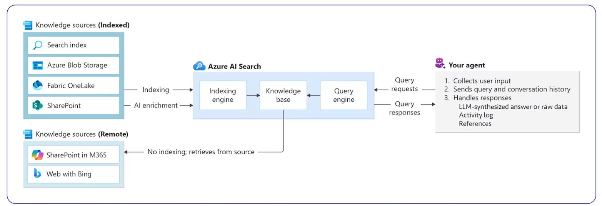

# Capabilities of Foundry IQ

| Capability | Description | Business Value |
|------------|-------------|----------------|
| **Shared Knowledge Layer** | Connect **one knowledge base** to **multiple agents**. | Eliminates duplicate indexes and ensures consistent knowledge across agents. |
| **Automated Knowledge Ingestion** | Automate document chunking, vector embedding generation, and metadata extraction for **indexed knowledge sources**. | Reduces operational complexity and accelerates onboarding of enterprise content. |
| **Flexible Retrieval Methods** | Issue **keyword**, **vector**, or **hybrid queries** across indexed and remote knowledge sources. | Improves retrieval accuracy by combining traditional and semantic search techniques. |
| **Agentic Retrieval Engine** | Uses an LLM to plan queries, select sources, run parallel searches, and aggregate results. | Delivers more intelligent and context-aware retrieval compared to traditional RAG approaches. |
| **Grounded Responses with Citations** | Returns **extractive data with citations** so agents can reason over raw content and trace answers back to source documents. | Improves trust, transparency, explainability, and compliance. |
| **Security & Governance Integration** | Synchronizes source **ACLs** and honors **Microsoft Purview sensitivity labels**. | Ensures enterprise security policies are consistently enforced. |
| **Identity-Based Access Control** | Runs queries under the caller's **Microsoft Entra ID** identity for end-to-end permission enforcement. | Prevents unauthorized data access and preserves existing security boundaries. |

## Foundry IQ at a Glance

**Foundry IQ** is Microsoft's enterprise knowledge and retrieval platform that enables AI agents to securely access, retrieve, and reason over organizational knowledge using an **agentic Retrieval-Augmented Generation (RAG)** architecture.

### Key Differentiators

- Single knowledge base shared across multiple agents
- Automated indexing and vectorization of enterprise content
- Keyword, vector, and hybrid search capabilities
- AI-driven retrieval planning and orchestration
- Citation-based grounded responses
- Native Microsoft Entra ID security enforcement
- Microsoft Purview compliance and governance integration

### Architecture Flow

```text
Enterprise Content
        ↓
Automated Ingestion
(Chunking + Metadata + Embeddings)
        ↓
Foundry IQ Knowledge Index
        ↓
Agentic Retrieval Engine
(Query Planning + Source Selection)
        ↓
Keyword / Vector / Hybrid Search
        ↓
Extractive Results with Citations
        ↓
LLM Reasoning
        ↓
Grounded AI Response
```

### Executive Summary

> Foundry IQ provides a secure, enterprise-grade agentic RAG platform that automatically indexes organizational knowledge, performs intelligent multi-source retrieval, enforces Microsoft Entra and Purview security controls, and delivers cited evidence that AI agents can use for accurate and trustworthy reasoning.

## Agentic Retrieval



