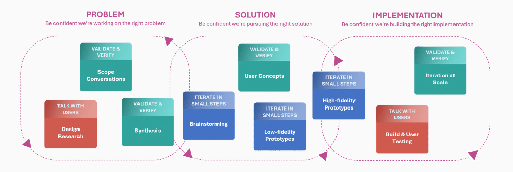

# Microsoft Hypervelocity Engineering (HVE)

Microsoft Hypervelocity Engineering (HVE) is Microsoft's emerging approach to **AI-driven software engineering**, where developers, architects, product managers, security engineers, and operations teams use AI agents and copilots throughout the entire software development lifecycle to dramatically increase delivery speed without sacrificing quality. 【1-27d810】【2-9dd58e】

## What HVE Is About

The key idea is that AI is not just a coding assistant. Instead, AI participates across:

- Requirements gathering
- Architecture and design
- Backlog creation
- Sprint planning
- Code generation
- Code reviews
- Security validation
- Testing
- Deployment
- Operations and incident management

Microsoft describes HVE as **AI-driven software development across the full lifecycle**, supported by reusable agents, prompts, skills, templates, and workflow guidance. 【1-27d810】【2-9dd58e】

## HVE Core

Microsoft has published an open-source framework called **HVE Core**, which provides:

- AI agents
- Engineering skills
- Workflow templates
- Architecture patterns
- Research-Plan-Implement (RPI) workflows
- Guidance for AI-assisted SDLC execution

The project is available publicly on GitHub and is intended to help teams adopt Hypervelocity Engineering practices with GitHub Copilot and AI agents. 【3-61504a】【1-27d810】

## The RPI Model (Research → Plan → Implement)

A central HVE concept is the **RPI workflow**:

### 1. Research
- Gather requirements
- Analyze existing systems
- Understand constraints

### 2. Plan
- Create architecture
- Define implementation approach
- Evaluate security, scalability, and risks

### 3. Implement
- Generate code
- Test
- Review
- Deploy

Rather than asking AI to "build everything," HVE emphasizes structured, incremental delivery. 【2-9dd58e】【4-201b3f】

## HVE Lifecycle

Microsoft's HVE guidance defines a nine-stage lifecycle:

| Stage | Activity |
|---------|----------|
| 1 | Setup |
| 2 | Discovery |
| 3 | Product Definition |
| 4 | Decomposition |
| 5 | Sprint Planning |
| 6 | Implementation |
| 7 | Review |
| 8 | Delivery |
| 9 | Operations |

Each stage has dedicated AI agents, instructions, and engineering skills. 【2-9dd58e】

## Why Microsoft Is Pushing HVE

The philosophy is that AI should increase:

- Developer productivity
- Software quality
- Engineering consistency
- Security compliance
- Documentation quality
- Time-to-market

while reducing:

- Repetitive coding
- Manual documentation
- Low-value engineering tasks
- Technical debt accumulation

Microsoft and industry leaders describe HVE as moving beyond simple AI coding assistants toward **agentic software engineering**, where AI becomes an active participant in engineering workflows. 【1-27d810】【4-201b3f】【5-948c1c】

## Why This Matters for Solution Architects

For Solution Architects, HVE shifts the focus from manually producing engineering artifacts to:

- Defining AI-operable architecture standards
- Creating reusable engineering patterns
- Establishing governance guardrails
- Orchestrating specialized AI agents
- Embedding security and compliance into AI workflows
- Scaling delivery across engineering teams

This aligns closely with Microsoft's broader investments in:

- GitHub Copilot
- Copilot Workspace
- Azure AI Foundry
- Agentic SDLC practices
- AI-powered DevOps methodologies

For enterprise architects, the value comes from enabling teams to move faster while maintaining consistency, security, traceability, and governance across the software development lifecycle. 【1-27d810】【6-27e833】

## Design Thinking for HVE
Spaces, mindsets, and methods to support solving the right problem the right way to create business value in an ISE engagement

## Key Takeaway

**Hypervelocity Engineering is Microsoft's vision for AI-first software development, where AI augments every phase of the engineering lifecycle rather than simply generating code.** The goal is not just faster development, but higher-quality delivery through structured workflows, reusable engineering knowledge, AI agents, and continuous governance. 【1-27d810】【2-9dd58e】