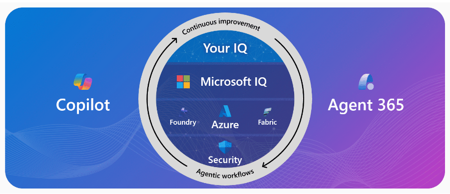
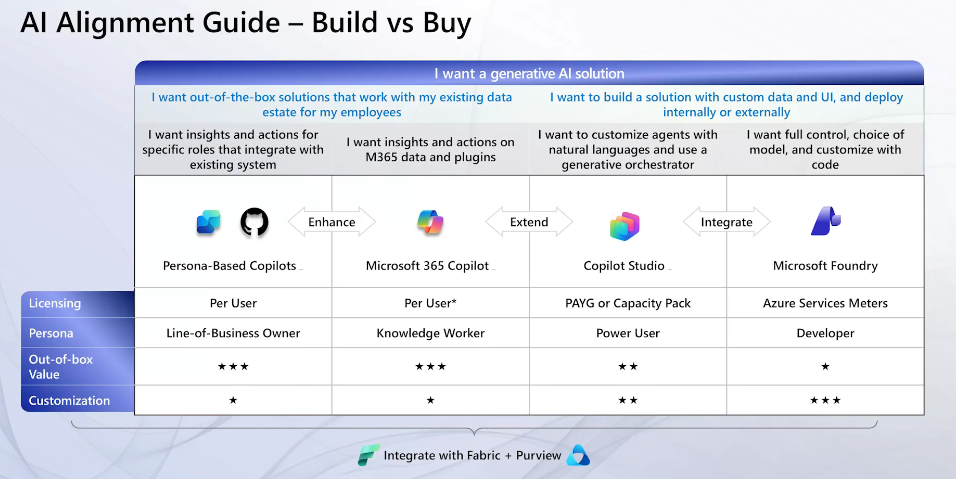
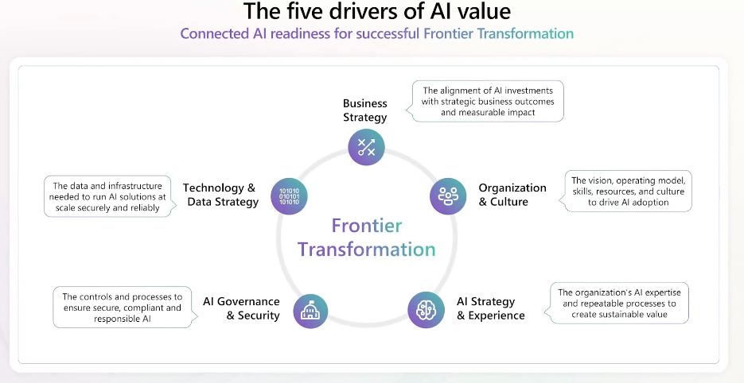

# Frontier Transformation
**The opportunity goes beyond AI adoption. It's realizing AI's potential**

## AI is Rewiring How Work Gets Done

| **From** | **To** |
|----------|--------|
| Siloed data | Integrated intelligence |
| AI assistant | AI doer |
| App centric | Connected system of work |
| Manual coordination | Human-agent collaboration |

## Empowering Frontier Transformation

## AI built for work
- Work IQ: The intelligence layer that personalizes Copilot to you and your organization
- Agentic Work: AI in the flow of work to get real work done
- Multi Model: The best model for every task and workflow
- Agent Platform: Ecosystem of agents with agent building tools for everyone
- Security & Management: Built-in security, management, and governance

## Build vs Buy

## Drivers of AI Value in Frontier Transformation

## Becoming Frontier

### Framework for AI Transformation

#### Strategic Business Outcomes

| Pillar | Description |
|----------|-------------|
| 👥 **Enrich Employee Experiences** | Improve workforce productivity, collaboration, engagement, and effectiveness through AI-powered experiences. |
| 💬 **Reinvent Customer Engagement** | Transform customer interactions using AI-driven personalization, support, and engagement. |
| ⚙️ **Reshape Business Processes** | Streamline and optimize operations through automation, intelligence, and AI-enabled workflows. |
| 💡 **Bend the Curve on Innovation** | Accelerate innovation cycles, unlock new business opportunities, and drive competitive advantage. |

---

### Data & AI Foundations
#### Critical Success Factors Based on Customer Learnings

#### 1. Leverage ALL YOUR DATA with Speed, Reduce Complexity & Cost
- Unify enterprise data across systems and platforms.
- Accelerate access to insights and decision-making.
- Simplify data management and integration architecture.
- Reduce operational and infrastructure costs.

#### 2. AI in the FLOW OF WORK: Meet and Empower Users Where They Are
- Embed AI directly into daily business applications and processes.
- Drive adoption by minimizing disruption to existing workflows.
- Enhance employee productivity through contextual assistance.
- Deliver AI experiences within familiar tools and environments.

#### 3. Enable AI Agents to Deeply UNDERSTAND Data
- Ground AI agents in organizational knowledge and business data.
- Improve reasoning, context awareness, and decision quality.
- Enable intelligent automation and agentic workflows.
- Create trusted and reliable AI-powered experiences.

#### 4. FUTURE-PROOF Tech Decisions with Open Standards, Flexibility and Extensibility
- Adopt interoperable and open technology architectures.
- Avoid vendor lock-in through standards-based integrations.
- Support evolving AI capabilities and future innovations.
- Enable scalability, customization, and ecosystem expansion.

---

### Framework Summary

Organizations become **Frontier AI Organizations** by focusing on four transformational outcomes:

1. Enrich Employee Experiences
2. Reinvent Customer Engagement
3. Reshape Business Processes
4. Bend the Curve on Innovation

These outcomes are enabled by strong **Data & AI Foundations**, built on:

- Unified enterprise data
- AI embedded in the flow of work
- Intelligent AI agents grounded in business context
- Open, flexible, and extensible technology architecture

The combination of these foundational capabilities allows organizations to accelerate AI adoption, improve operational efficiency, drive business transformation, and achieve sustainable competitive advantage.
