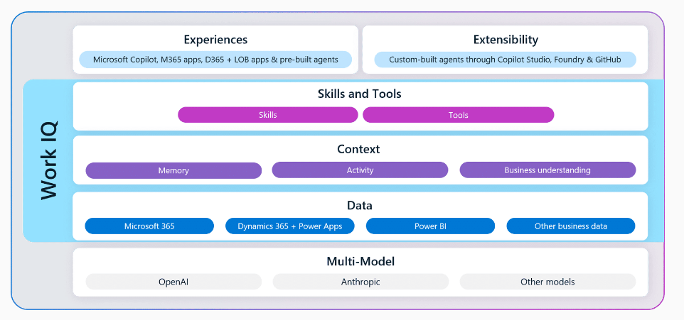
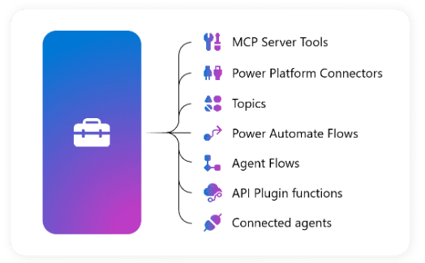

# Work IQ

The intelligence layer that personalizes Copilot to you and your organization

## Components
| Component | Description |
|-----------|-------------|
| **Skills and Tools** | Provides specialized instructions to customize Copilot and agents to deliver tailored experiences optimized for specific tasks. |
| **Context** | Uses memory to learn from your unique style, preferences, habits, and workflows, understanding your work patterns over time. |
| **Data** | Combines everyday work with external data, including M365 signals and LOB data to give Copilot real-time understanding. |

## Tools

- Execute against the intent of skills invoked through Work IQ to provide responses to Copilot users.

- Provide trustworthy, repeatable outcomes based on structured and unstructured where inferenced responses are not appropriate.

- Customers can build agents and add skills and tools that, in combination with our orchestration services, can also be used with Work IQ.

